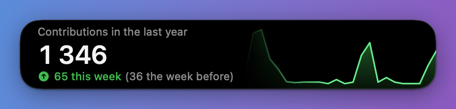
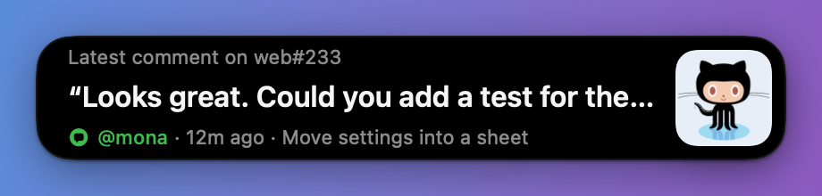
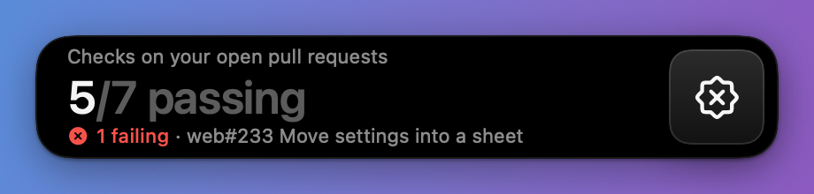

# Dock Notch

A small black pill that sits next to the macOS Dock and cycles through your GitHub activity:
contributions, open pull requests, the latest comment, review requests, CI checks and
recently merged work. Data comes from the [GitHub CLI](https://cli.github.com), so there are
no tokens to set up.





## Requirements

- macOS 14 or later, Swift 6 toolchain (Xcode 16+)
- `gh`, signed in: `brew install gh && gh auth login`

## Run it

```bash
make run        # build build/DockNotch.app and open it
make install    # copy it to /Applications and open it
```

On first launch macOS asks for **Accessibility** access. Dock Notch uses it only to read the
Dock's size, so the pill can sit exactly beside it and follow it as apps come and go. Without
it, the pill sits at the right edge of the Dock's strip instead. You can grant it later from the
right-click menu.

`scripts/bundle.sh` signs the app with your Apple Development identity when one is installed,
so the Accessibility grant survives rebuilds. Override it with `SIGN_IDENTITY="…"`.

## Using it

- Cards rotate every 7 seconds. Hovering pauses the rotation.
- Scroll over the pill to flip between cards.
- Click a card to open it on GitHub (the comment, the failing PR, your PR list, and so on).
- When something changes (a new comment, a new review request, a failing check, a merge),
  the pill jumps to that card and glows briefly.
- Right-click for Refresh, Open at Login and Quit.

## Settings

Settings live in `defaults` under `com.rikuws.docknotch`. Restart the app after changing them.

| Key | Default | What it does |
| --- | --- | --- |
| `searchQualifier` | none | Extra search qualifiers for every query, such as `org:acme` or `repo:me/app` |
| `refreshInterval` | `60` | Seconds between GitHub fetches (minimum 20) |
| `rotationInterval` | `7` | Seconds each card stays up |
| `pillWidth` | `420` | Width of the pill in points |
| `ghPath` | auto | Path to `gh` if it isn't in Homebrew, `/usr/local/bin` or your login shell's PATH |

```bash
defaults write com.rikuws.docknotch searchQualifier "org:acme"
```

## How it works

- `GitHub/GitHubClient.swift` makes one `gh api graphql` call per refresh (it costs 1 point of
  the 5,000/hour rate limit). It runs four searches (your open PRs, review requests, PRs merged
  this week, and recent PRs involving you) and reads your contribution calendar.
- `GitHub/Snapshot.swift` turns that into the numbers on the cards. The "latest comment" is the
  newest comment or review by someone other than you, ignoring bots; your own comments show
  only when nobody else has said anything.
- `DockTracker.swift` reads the Dock's frame from its accessibility tree once a second, and
  every 60 ms for a moment after an app launches or quits, so the pill follows the Dock's
  resize animation.
- `NotchPanel.swift` is a borderless, non-activating panel one level above the Dock. It shows on
  every Space and stays out of full-screen apps, like the Dock.
- `Views/` holds the SwiftUI pill. Card rows swap with a staggered lift-and-blur, counts tick with
  numeric text transitions, and the contribution chart draws in from the left.

### Previewing cards

```bash
swift run DockNotch --render /tmp/cards            # every card with your live data
swift run DockNotch --render /tmp/cards --sample   # made-up data that fills every card
```
