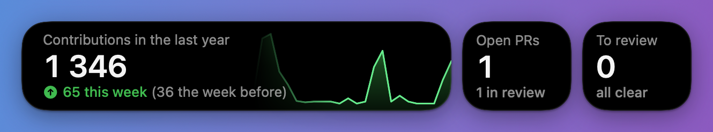
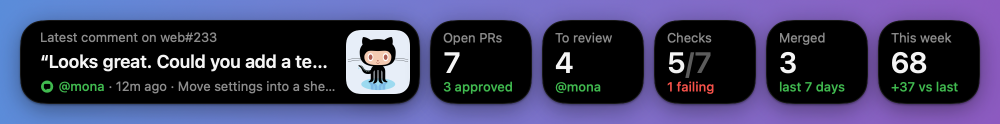

# Dock Notch

A strip of black boxes that fills the space beside the macOS Dock with your GitHub activity.
A rotating card cycles through contributions, open pull requests, the latest comment, review
requests, CI checks and recently merged work. When there's room, small tiles keep the key
numbers visible all the time. Data comes from the [GitHub CLI](https://cli.github.com), so there
are no tokens to set up.




## Requirements

- macOS 14 or later, Swift 6 toolchain (Xcode 16+)
- `gh`, signed in: `brew install gh && gh auth login`

## Run it

```bash
make run        # build build/DockNotch.app and open it
make install    # copy it to /Applications and open it
```

On first launch macOS asks for **Accessibility** access. Dock Notch uses it only to read the
Dock's size, so the strip can fill exactly the space beside it and follow it as apps come and
go. Without it, only the rotating card shows, at the right edge of the Dock's area, and an
auto-hiding Dock can't be followed, so the card stays up. You can grant it later from the
right-click menu.

`scripts/bundle.sh` signs the app with your Apple Development identity when one is installed,
so the Accessibility grant survives rebuilds. Override it with `SIGN_IDENTITY="…"`.

## Using it

- The strip matches the Dock: the same height and vertical position as the Dock's glass, a
  10pt gap between the Dock, each box and the screen edge, and the Dock's 10pt inset inside
  each box. It scales with your Dock size.
- The strip comes and goes with the Dock. When the Dock auto-hides, or a full-screen app takes
  over its screen, the strip slides away too, and it slides back when the Dock does.
- The rotating card keeps about 400pt; tiles for open PRs, review requests, checks, merges and
  this week's contributions are added in that order as space allows.
- A tile takes its card out of the rotation, so the card only cycles through what the tiles
  don't already show.
- Cards rotate every 7 seconds. Hovering pauses the rotation.
- Scroll over the strip to flip between cards.
- Click a card or tile to open it on GitHub (the comment, the failing PR, your PR list, and so on).
- When something changes (a new comment, a new review request, a failing check, a merge), the
  tile showing it glows briefly, or the card jumps to it and glows.
- Right-click for Refresh, Open at Login and Quit.

## Settings

Settings live in `defaults` under `com.rikuws.docknotch`. Restart the app after changing them.

| Key | Default | What it does |
| --- | --- | --- |
| `searchQualifier` | none | Extra search qualifiers for every query, such as `org:acme` or `repo:me/app` |
| `refreshInterval` | `60` | Seconds between GitHub fetches (minimum 20) |
| `rotationInterval` | `7` | Seconds each card stays up |
| `maxTiles` | `5` | Most tiles to show beside the card; `0` shows the card alone |
| `ghPath` | auto | Path to `gh` if it isn't in Homebrew, `/usr/local/bin` or your login shell's PATH |

```bash
defaults write com.rikuws.docknotch searchQualifier "org:acme"
```

## How it works

- `GitHub/GitHubClient.swift` makes one `gh api graphql` call per refresh (it costs 1 point of
  the 5,000/hour rate limit). It runs four searches (your open PRs, review requests, PRs merged
  this week, and recent PRs involving you) and reads your contribution calendar.
- `GitHub/Snapshot.swift` turns that into the numbers on the cards. The "latest comment" is the
  newest comment or review by someone other than you, ignoring bots; your own comments show
  only when nobody else has said anything.
- `DockTracker.swift` reads the Dock's frame from its accessibility tree once a second, and
  every 60 ms for a moment after an app launches or quits, so the strip follows the Dock's
  resize animation. On macOS 26 that frame sits about 4.5pt above the glass you see, so the
  vertical position comes from the top of the screen area reserved for the Dock instead.
  A hidden Dock's frame sits off screen; once it's more than halfway out, the Dock counts as
  hidden. A hidden Dock is checked every 250 ms, and every 60 ms while the pointer is near
  the edge it slides in from.
- `NotchPanel.swift` is a borderless, non-activating panel one level above the Dock. It shows on
  every Space, full-screen ones included, so it can come out with the Dock over a full-screen
  app. `AppDelegate.swift` keeps it hidden whenever the Dock is.
- `Views/StripLayout.swift` decides how many tiles fit and how wide each box is. The view runs it
  on its live size, so the strip reflows smoothly while the Dock resizes.
- `Views/` holds the rest of the SwiftUI strip. Card rows swap with a staggered lift-and-blur,
  counts tick with numeric text transitions, and the contribution chart draws in from the left.

### Previewing cards

```bash
swift run DockNotch --render /tmp/cards --width 625            # live data, 625pt of space
swift run DockNotch --render /tmp/cards --sample --width 960   # made-up data, wider strip
```
