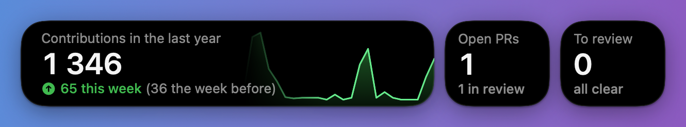
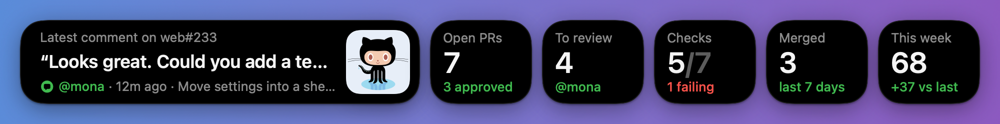

# Dock Notch

A strip of black boxes that fills the space beside the macOS Dock with your GitHub activity.
A rotating card cycles through contributions, open pull requests, the latest comment, review
requests, CI checks and recently merged work. When there's room, small tiles keep the key
numbers visible all the time. Data comes from the [GitHub CLI](https://cli.github.com), so there
are no tokens to set up.




## Install

[Download DockNotch.dmg](https://github.com/rikuws/dock-notch/releases/latest/download/DockNotch.dmg),
open it and drag Dock Notch to Applications. It's signed and notarized, and keeps itself up
to date.

It needs macOS 14 or later and the GitHub CLI, signed in:
`brew install gh && gh auth login`.

## Make it your own

Change anything you like with your coding agent, and keep getting updates:

```bash
git clone https://github.com/rikuws/dock-notch.git && cd dock-notch
make customize IDEA="add a tile counting open issues assigned to me"
```

Your changes stay commits on top of the release, and each new release they move onto it,
with your agent carrying over any that clash. Or skip the source entirely and have your
agent build its own from [PROMPT.md](PROMPT.md). [CUSTOMIZING.md](CUSTOMIZING.md) covers
both.

## Build from source

You need Xcode 16 or later, which brings the Swift 6 toolchain, and `gh` as above.

```bash
make run        # build build/DockNotch.app and open it
make install    # copy it to /Applications and open it
make update     # move onto the newest release, keeping your changes, and reinstall
```

On first launch macOS asks for **Accessibility** access. Dock Notch uses it only to read the
Dock's size, so the strip can fill exactly the space beside it and follow it as apps come and
go. Without it, only the rotating card shows, at the right edge of the Dock's area, and an
auto-hiding Dock can't be followed, so the card stays up. You can grant it later from the
right-click menu.

`scripts/bundle.sh` signs the app with your Apple Development identity when one is installed,
so the Accessibility grant survives rebuilds. Override it with `SIGN_IDENTITY="…"`.

## Using it

- The strip matches the Dock: the same height and vertical position as the Dock's glass, a
  10pt gap between the Dock, each box and the screen edge, and the Dock's 10pt inset inside
  each box. It scales with your Dock size.
- The strip comes and goes with the Dock. When the Dock auto-hides, or a full-screen app takes
  over its screen, the strip slides away too, and it slides back when the Dock does. While
  you hover over it or its popover, it stays out even if the Dock hides.
- The rotating card keeps about 400pt; tiles for open PRs, review requests, checks, merges and
  this week's contributions are added in that order as space allows. Tiles are all one size,
  like Dock icons, and the card takes whatever space is left, up to 600pt.
- A tile takes its card out of the rotation, so the card only cycles through what the tiles
  don't already show.
- Cards rotate every 7 seconds, adjusted by what they ask of you. A card with something new
  that needs you (a review request, a failing check, a comment from someone else today, a PR
  that's ready to merge or sent back) stays twice as long. Once you've seen it, by hovering
  it, opening it in the window or letting it stay up its full time, it stays a quarter longer
  than usual. Cards that are only numbers (contributions, merges, all checks passing) stay
  about two thirds as long and come round every other lap.
- Rest the pointer on the card or a tile and a popover opens above it with the detail behind
  it, so you don't have to open GitHub:
  - **Latest comment**: the conversation on that pull request, with full comments, review
    verdicts, inline comments with their file, quotes, code and suggested changes. It opens
    scrolled to the newest.
  - **Open PRs**: each one with what it needs, most urgent first (failing checks, changes
    requested, ready to merge, in review, drafts), and its size.
  - **To review**: who asked, how big it is and how long it's been open.
  - **Checks**: which checks failed or are still running, by name.
  - **Merged**: what merged and when.
  - **Contributions** and **This week**: the last two weeks day by day, your streak, how the
    week compares and your busiest day.

  Boxes with nothing more to show get no popover. Once one is open, moving to another box
  switches it right away. Click a row to open it on GitHub.
- While the pointer is on the strip or a popover, nothing changes under it: the card doesn't
  rotate or jump to news, and fresh data waits until the pointer leaves (Refresh Now still
  applies at once).
- Scroll over the strip to flip between cards.
- Click a card or tile to open it on GitHub (the comment, the failing PR, your PR list, and so on).
- When something changes (a new comment, a new review request, a failing check, a merge), the
  tile showing it glows briefly, or the card jumps to it and glows.
- Right-click for Refresh, Open Window, Open at Login, Check for Updates and Quit. The menu also shows
  which version you're running.

## The window

For a proper look whenever you want, open a larger card in the middle of the screen with
the whole of a section: every pull request waiting for your review, all your open PRs, the
full conversation. It uses the popovers' style, with tabs for each section. A green dot on a
tab means something new needs you there; a grey one, something you've already seen.

Open it with **Open Window** (⌘O) in the right-click menu, or with a link, which you can
bind to a hotkey in Raycast, Shortcuts or anything else that opens URLs:

| Link | What it does |
| --- | --- |
| `docknotch://show` | Opens on whatever new thing needs you, or the card on the strip |
| `docknotch://show/reviews` | Opens on a section: `reviews`, `prs`, `checks`, `comments`, `activity` or `merged` |
| `docknotch://toggle/reviews` | The same, but closes the window if it's already showing that section. The section is optional |
| `docknotch://close` | Closes the window |
| `docknotch://refresh` | Fetches from GitHub now |

In the window, ← → or Tab switch sections, 1–6 jump to one, ↑ ↓ pick a row and ↩ opens it on
GitHub. ⌘R refreshes. Esc or a click anywhere else closes it.

```bash
open docknotch://toggle/reviews
```

## Updates

- **Downloaded copies** check for a new release once a day with
  [Sparkle](https://sparkle-project.org) and ask before installing it. Each update is
  signed, and Dock Notch checks that signature before installing. To stop the daily
  check: `defaults write com.rikuws.docknotch SUEnableAutomaticChecks -bool NO`.
- **Builds from source** check the same releases every six hours and offer to run
  `make update`, which rebuilds from the new release with your changes on top (see
  [CUSTOMIZING.md](CUSTOMIZING.md)).

## Settings

Settings live in `defaults` under `com.rikuws.docknotch`. Restart the app after changing them.

| Key | Default | What it does |
| --- | --- | --- |
| `searchQualifier` | none | Extra search qualifiers for every query, such as `org:acme` or `repo:me/app` |
| `refreshInterval` | `60` | Seconds between GitHub fetches (minimum 20) |
| `rotationInterval` | `7` | Seconds each card stays up |
| `maxTiles` | `5` | Most tiles to show beside the card; `0` shows the card alone |
| `ghPath` | auto | Path to `gh` if it isn't in Homebrew, `/usr/local/bin` or your login shell's PATH |

```bash
defaults write com.rikuws.docknotch searchQualifier "org:acme"
```

## How it works

- `GitHub/GitHubClient.swift` makes one `gh api graphql` call per refresh (it costs 2 points of
  the 5,000/hour rate limit). It runs four searches (your open PRs with their checks, review
  requests, PRs merged this week, and recent open PRs involving you with their latest comments
  and reviews) and reads your contribution calendar. Comments on merged or closed PRs never
  reach the card.
- `GitHub/Snapshot.swift` turns that into the numbers on the cards. The "latest comment" is the
  newest comment or review by someone other than you, ignoring bots; your own comments show
  only when nobody else has said anything.
- `DockTracker.swift` reads the Dock's frame from its accessibility tree once a second, and
  every 60 ms for a moment after an app launches or quits, so the strip follows the Dock's
  resize animation. On macOS 26 that frame sits about 4.5pt above the glass you see, so the
  vertical position comes from the top of the screen area reserved for the Dock instead.
  A hidden Dock's frame sits off screen; once it's more than halfway out, the Dock counts as
  hidden. A hidden Dock is checked every 250 ms, and every 60 ms while the pointer is near
  the edge it slides in from.
- `NotchPanel.swift` is a borderless, non-activating panel one level above the Dock. It shows on
  every Space, full-screen ones included, so it can come out with the Dock over a full-screen
  app. `AppDelegate.swift` keeps it hidden whenever the Dock is. When the Dock moves to
  another display, the strip doesn't slide across: a window dragged between a Retina and a
  non-Retina display can stay in place but stop being drawn. It hides and comes up afresh on
  the new display instead.
- `SectionWindow.swift` is the larger window and its keyboard handling; `AppDelegate.swift`
  routes `docknotch://` links to it.
- `Views/StripLayout.swift` decides how many tiles fit and how wide each box is. The view runs it
  on its live size, so the strip reflows smoothly while the Dock resizes.
- `Views/` holds the rest of the SwiftUI strip. Card rows swap with a staggered lift-and-blur,
  counts tick with numeric text transitions, and the contribution chart draws in from the left.
- `DetailPanel.swift` opens the popovers: after 350 ms on a box, then instantly from box to box
  while one is open, closing 250 ms after the pointer leaves both the strip and the popover.
  `Views/DetailModel.swift` decides what each popover says and parses comment Markdown;
  `Views/DetailView.swift` draws it. The app is rarely active, so AppKit doesn't send it
  mouse moves; both panels follow the pointer with event monitors while it's over them.
- `Updates/` keeps the app current. `scripts/bundle.sh` stamps Info.plist with where a
  build came from: a release (`CHANNEL=release`) updates with Sparkle from the appcast on
  the latest GitHub release; a build from source records its checkout and commit, and
  `SourceUpdater.swift` watches the upstream releases and runs `make update` in that
  checkout. [RELEASING.md](RELEASING.md) covers publishing a release.

### Previewing cards

```bash
swift run DockNotch --render /tmp/cards --width 625                       # live data, 625pt of space
swift run DockNotch --render /tmp/cards --sample --width 960              # made-up data, wider strip
swift run DockNotch --render /tmp/cards --sample --width 960 --details    # plus each card's popover
```
